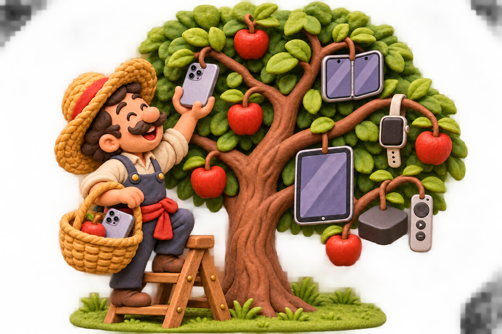

# Manzanero

Manzanero lets you inspect and control Apple devices from your Mac, either through terminal commands or an AI agent. Use it to capture screens, read on-screen controls, tap, swipe, type, manage apps and record test sessions. Its command-line interface and optional MCP server share the same operations, using Apple developer tools and frameworks.

The project is in beta.

Physical iPhone control is the current priority, and reliable unattended testing is still unfinished. iPhone, iPad, Apple Watch, Apple TV and iPhone Duo are in scope, with support varying by device and operation.

Most live evidence comes from one iPhone 13 mini; see [feature status](docs/feature-status.md) before relying on another device or operation.



*Manzanero* is Spanish for an apple tree or a person who grows or gathers apples—a fitting name for a tool that tends to your Apple devices.

## Build and start

You need macOS 15+, a full selected Xcode installation, Swift 6.4+, [mise](https://mise.jdx.dev/) and xcsift. The package declares Swift 6.2 language support, but its pinned dependency graph currently requires a Swift 6.4 toolchain. Native physical video requires macOS 26+.

```sh
mise run build
mise run cli -- --help
mise run cli devices physical
mise run cli devices simulators
mise run cli doctor
```

`mise run cli` runs the built executable; it does not build it. In the guides below, substitute `mise run cli` for bare `manzanero` when working from this checkout, or run `.build/debug/manzanero` directly. A source build does not install a global command.

Replace angle-bracket placeholders with your values. For physical commands, choose the hardware UDID from the physical inventory, rather than a simulator UUID. Create output parent directories before capturing or copying files.

There is no published beta release or Homebrew formula yet. See [beta installation](docs/beta-testing.md), [release preparation](docs/releasing.md) and the [public-readiness review](docs/public-readiness.md).

## Prepare a physical device

Pair and trust the Mac using Apple's normal setup. Enable Developer Mode and **Settings → Developer → Enable UI Automation** on the device. Keep it awake and unlocked for the verified UI flows.

```sh
mise run cli physical <hardware-UDID> readiness
```

The top-level readiness status covers CoreDevice prerequisites. Inspect its separate `ui` report for display power and passcode observations. Neither report verifies UI Automation permission or proves that the current UI is unlocked. [Readiness guidance](docs/readiness.md) explains the fields and preparation steps.

## Observe, act, inspect again

```sh
mise run cli physical <UDID> screenshot tmp/before.png
mise run cli physical <UDID> tree
mise run cli physical <UDID> tap 0.5 0.5
mise run cli physical <UDID> screen auto
```

Physical touch coordinates are normalized `0...1`, with the origin at the top left. Accessibility frames use logical points; screenshot dimensions use pixels. A dispatch receipt does not verify an action's effect. Inspect fresh state after every action, especially after an error or interruption.

| Need | Command or guide |
| --- | --- |
| Buttons, tap, swipe, drag, long press | [Physical input](docs/native-input.md) |
| Pinch or coordinated contacts | [Multitouch](docs/multitouch.md), [timed sequences](docs/gesture-sequences.md) |
| Text entry | [ASCII typing](docs/physical-typing.md), [Unicode paste](docs/native-input.md#direct-unicode-paste) |
| Screen, hierarchy, OCR | [Screen inspection](docs/screen-understanding.md), [accessibility](docs/direct-accessibility.md) |
| Exact accessibility press or scroll | [Selector actions](docs/direct-accessibility.md#current-guarded-native-press) |
| Video | [Recording](docs/recording.md) |
| Build, install and launch an iOS app | [Build & Run](docs/build-run.md) |
| A step that needs a person | [Human handoff](docs/handoff.md) |

Physical input, accessibility and native video need no separate device helper. AXe, idevice and ipb executables are blocked at runtime. Simulator app/lifecycle/capture commands use `simctl`; simulator input and hierarchy remain unavailable pending direct replacements.

## Apps, files and reports

These commands use the selected Xcode's `devicectl`:

```sh
mise run cli physical <device> apps
mise run cli physical <device> processes
mise run cli physical <device> launch com.example.app
mise run cli physical <device> terminate <positive-PID>
mise run cli physical <device> install 'tmp/My App.app'
mise run cli physical <device> files com.example.app Documents
mise run cli physical <device> pull com.example.app Documents/data.json tmp/data.json
mise run cli physical <device> reports
mise run cli physical <device> report 'My App.ips' 'tmp/My App.ips'
```

Container paths are relative; `.` means the selected domain's root. Listings are nonrecursive. Access depends on the app/device's authorization. Copies can overwrite destinations; these commands do not provide `.xcappdata` export, symbolication or whole-container replacement. Physical termination takes a PID; simulator termination takes a bundle identifier.

Use `--dry-run` before a planned command to inspect its arguments without executing it. Most physical wrappers preserve `devicectl` JSON; some simulator commands return plain text. CLI errors currently use stderr text and a nonzero exit code.

## MCP

Configure your host to launch the executable by absolute path with argument `mcp`. The server shares the CLI's operations and backend limits.

```json
{
  "mcpServers": {
    "manzanero": {
      "command": "/absolute/path/to/manzanero",
      "args": ["mcp"]
    }
  }
}
```

Host configuration formats vary. Set a suitable working directory: relative files and temporary artifacts are created there. The host controls approvals; the server has no approval UI of its own. See [MCP tools and lifecycle](docs/mcp.md).

## Limits that matter

- Native input and AX actions are experimental. Successful transport acknowledgements are not UI assertions.
- Native video has scoped CLI/MCP verification, including one five-minute capture and one recording with AX inspection and Home control. Startup remains intermittent; keyframe, crash and disconnect recovery are unfinished.
- SIGINT/SIGTERM and MCP EOF attempt owned cleanup. Forced exits, failed transports and multiple independent controllers do not have a release guarantee.
- Live screen mirroring, stable reusable element handles, broad Apple-family coverage and several simulator/diagnostic paths remain incomplete.
- Screenshots, app lists, logs, clipboard data and artifacts under `tmp/` can contain private information. Do not commit or share them without review.

## For contributors

Run `mise run test` for local checks and `mise tasks validate` for task definitions. Device tests are opt-in and may mutate the selected device; read their help first.

Start with [architecture and dependencies](docs/dependencies.md), [development tasks](docs/development-tasks.md), [roadmap](docs/roadmap.md) and [verification](docs/verification.md). Protocol and implementation references are collected in [accessibility notes](docs/accessibility-protocol.md), [transport notes](docs/transport.md) and the [AXe review](docs/axe-physical-review.md). The [touch probe](docs/touch-probe.md) is a fixture iOS app for measuring physical touch delivery. Repository workflow rules are in [AGENTS.md](AGENTS.md).


## License

Manzanero is available under the [MIT license](license). Third-party components retain their respective licenses and notices in `ThirdParty/`.
